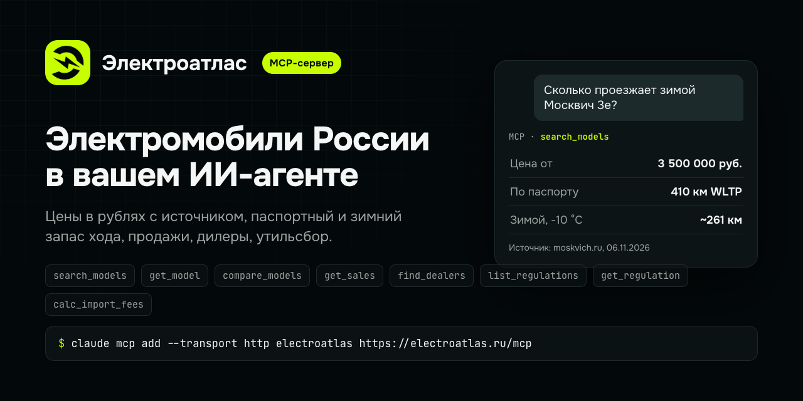

# Электроатлас - MCP-сервер

Электромобили и гибриды в России для AI-агентов: цены в рублях с источником, паспортный и зимний запас хода,
сравнение, продажи по моделям, дилеры по городам, утильсбор, НДС и субсидия.

*Electric cars and hybrids in Russia for AI agents: rouble prices with sources, winter range, sales, dealers, EV rules.
Answers are in Russian.*

- **Сервер:** `https://electroatlas.ru/mcp` - удалённый, Streamable HTTP, только чтение, без входа и ключа.
- **Имя в реестре MCP:** `ru.electroatlas/catalog`.

Здесь лежат файлы подключения, плагин и навык. Сам сервер работает на electroatlas.ru.

## Инструменты

| Инструмент | Что делает |
| --- | --- |
| `search_models` | Поиск модели по названию, бюджету, зимнему запасу хода. |
| `get_model` | Всё об одной машине: цены, запас хода, батарея, оценка, проблемы, фото с автором. |
| `compare_models` | Сравнение моделей: "что взять, X или Y". |
| `get_sales` | Что регистрируют чаще всего; продажи одной модели. |
| `find_dealers` | Дилеры марки в городе: адрес, телефон, источник. |
| `list_regulations` | Правила: утильсбор, НДС, субсидия, ввоз. |
| `get_regulation` | Одно правило целиком: ставки утильсбора по мощности, акты, хронология. |
| `calc_import_fees` | Расчёт утильсбора и всей растаможки по мощности, возрасту и стоимости. |

## Подключить

| Клиент | Как |
| --- | --- |
| Claude, Claude Desktop | Настройки - Коннекторы - Добавить свой коннектор - `https://electroatlas.ru/mcp` |
| Claude Code | `claude mcp add --transport http electroatlas https://electroatlas.ru/mcp` |
| Claude Code, плагином | `/plugin install electroatlas --marketplace electroatlas/mcp` |
| ChatGPT | Настройки - Приложения - режим разработчика - Создать - адрес `https://electroatlas.ru/mcp`, без входа |
| Cursor | [`.mcp.json`](.mcp.json) в проект или в `~/.cursor/mcp.json` |
| VS Code | `code --add-mcp '{"name":"electroatlas","type":"http","url":"https://electroatlas.ru/mcp"}'` |
| Codex | `codex mcp add electroatlas --url https://electroatlas.ru/mcp` |
| Gemini CLI | `gemini extensions install https://github.com/electroatlas/mcp` |

Без MCP: программа командной строки одним файлом - `curl -fsSLO https://electroatlas.ru/cli/electroatlas.mjs`,
затем `node electroatlas.mjs search <модель>`.

## Примеры вопросов

- Сколько проезжает зимой Москвич 3е и откуда эта цифра?
- Сравни Zeekr 001 и Li Auto L7 по цене в рублях и запасу хода.
- Какой утильсбор на электромобиль, ввезённый в 2026 году?

## Условия

Данные и фото: https://electroatlas.ru/legal/terms. Конфиденциальность: https://electroatlas.ru/legal/privacy.
Ошибка в данных: https://electroatlas.ru/legal/corrections. Почта: info@electroatlas.ru.
Файлы этого репозитория - под MIT; на данные, которые отдаёт сервис, эта лицензия не распространяется.
